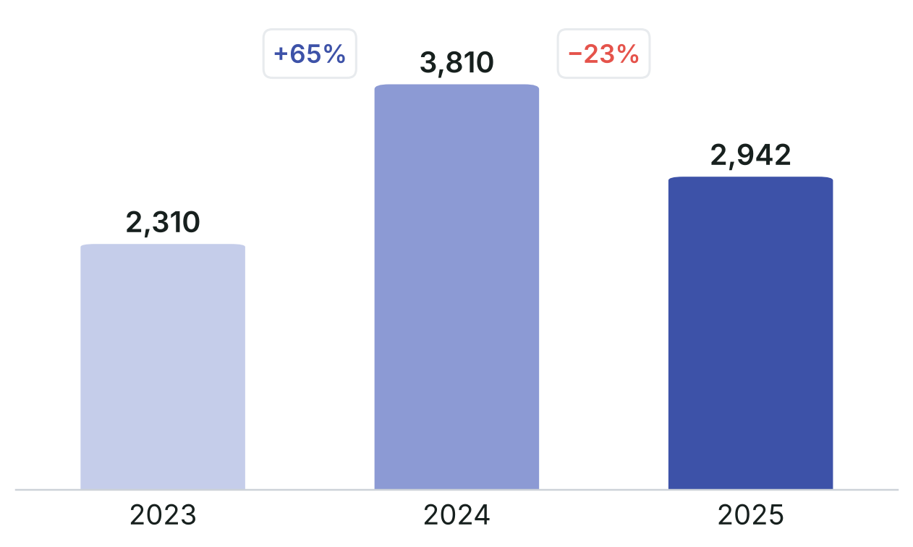
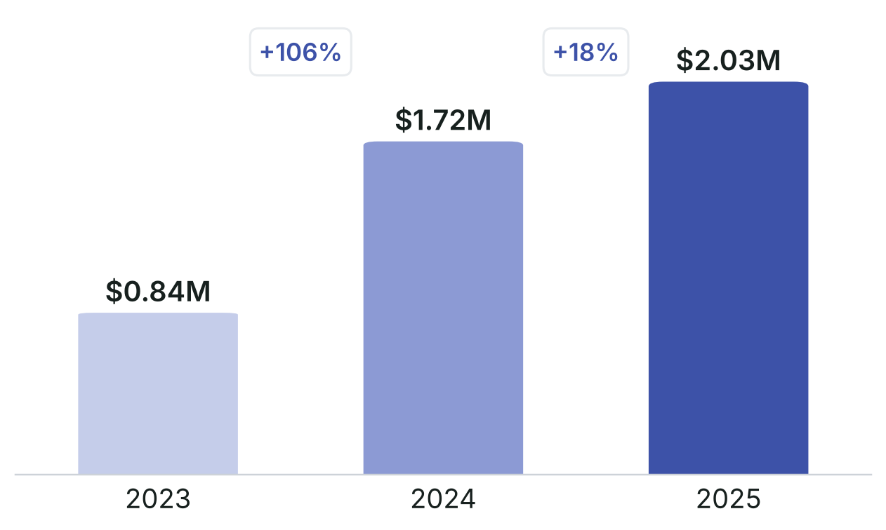
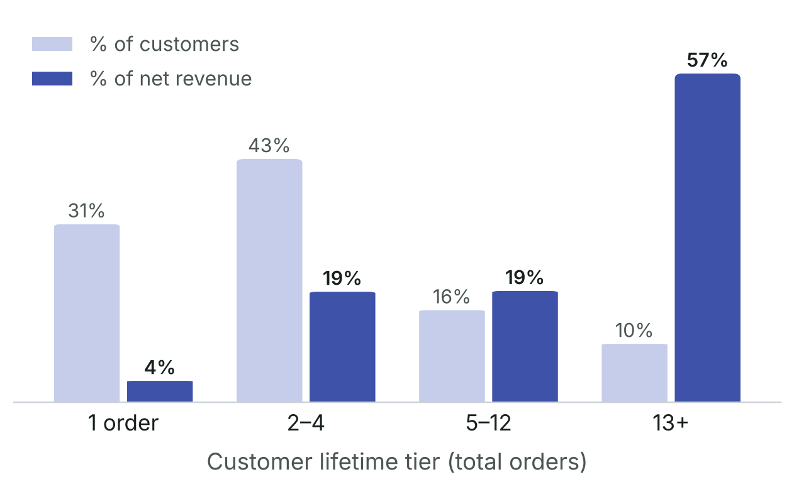
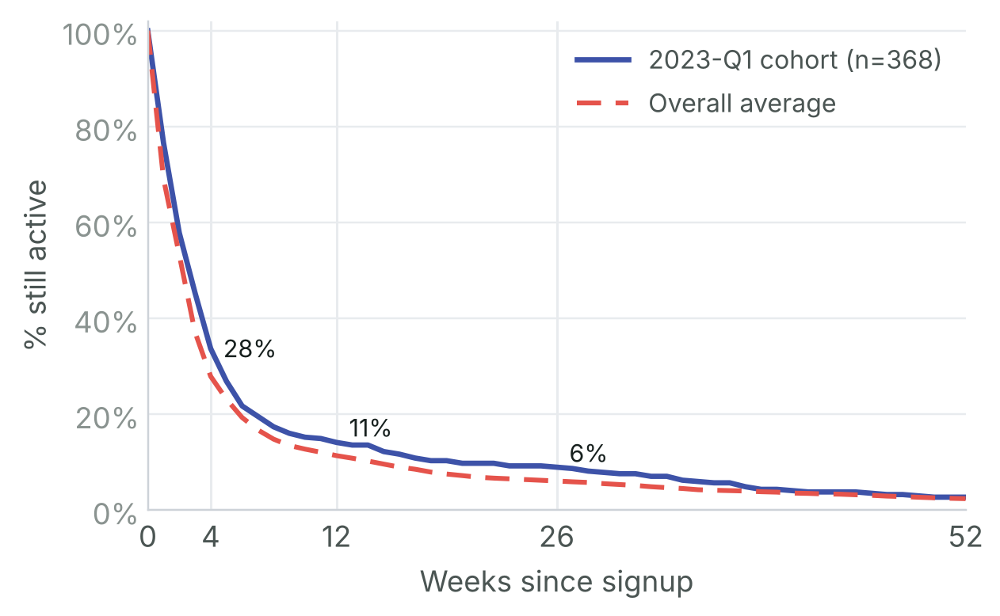
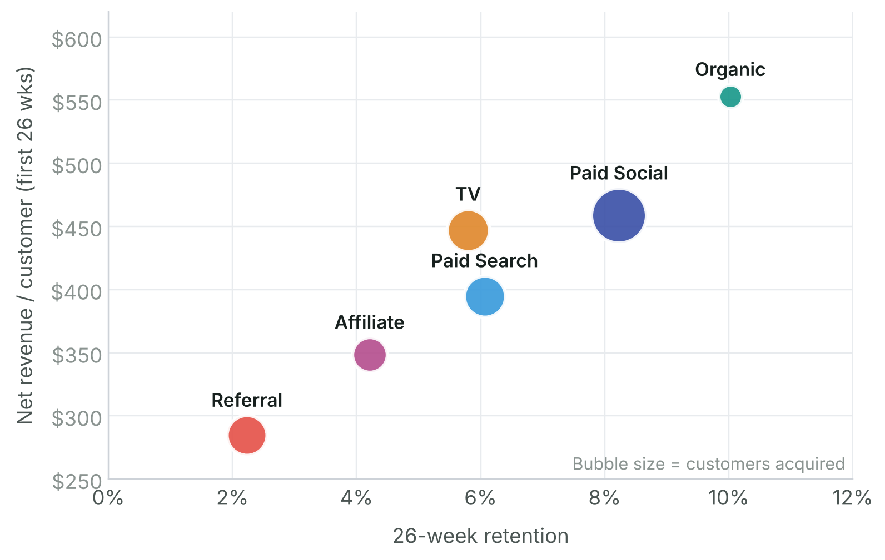
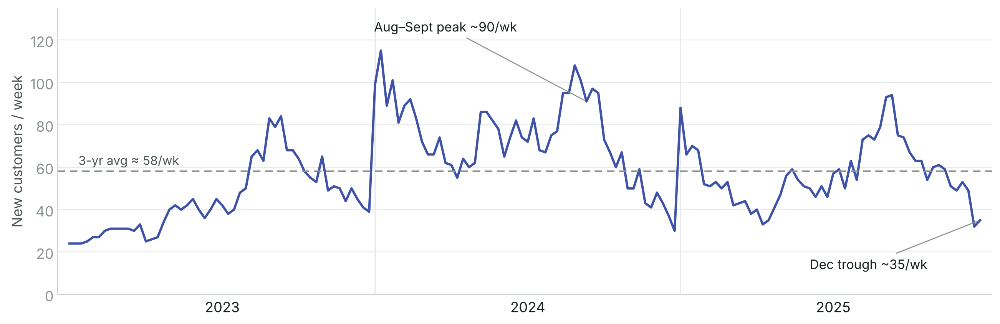

# Harvest & Co. — 2026 Customer Acquisition & Budget Strategy

Three years of delivery data from a meal-kit subscription company, analysed to answer one question: **where should the 2026 marketing budget and acquisition effort go?**

Harvest & Co. is a fictional meal-kit company used for this case study. Customers subscribe to weekly recipe boxes (2, 4 or 6 recipes). The dataset covers 53,824 deliveries to 9,062 customers over 156 weeks (2023-W01 to 2025-W52).

📄 **[Read the strategy deck (PDF, 20 slides)](reports/Harvest_and_Co_2026_Growth_Strategy.pdf)**

---

## Key findings

**1. Acquisition is contracting, but revenue is still growing.** New customers fell 23% in 2025 (3,810 → 2,942) after a 2024 spike, settling back near the ~58/week baseline. Net revenue still rose 18% ($1.72M → $2.03M), even though active customers fell 19%.

 

**2. The growth came from order frequency, not price.** Net revenue per active customer rose from $427 to $620 (+45%) while revenue per delivery stayed flat at about $85. That makes 2025 growth dependent on a smaller, more loyal base.

**3. A small core of repeat customers drives most of the value.** About 10% of customers (13+ orders) generate 57% of net revenue, while 31% never place a second order. Only ~28% of a cohort is still active by week 4.

 

**4. The highest-volume channels are not the highest-value ones.** Organic customers are worth the most ($553 in the first 26 weeks, 10.0% retention) but it is the smallest channel. Paid Social is the largest and solidly above average. Referral is mid-sized with the weakest economics: $285 per customer, 2.2% retention and a 57%-off first box. The channel ranking holds at 12, 26 and 52-week windows.



**5. Discounts are spent where value isn't.** 73.5% of discount dollars go on first orders, but first orders produce only 12.3% of net revenue.

**6. Acquisition is strongly seasonal.** New customers peak in late August / September (~90/week) and bottom out in late December (~35/week). The January 2026 forecast is **~264 new customers** over weeks 1–4 (planning range ~230–300).



## Recommendations

| Priority | Action | Why |
|---|---|---|
| Highest | **Fix second-box conversion** | 31% never reorder; retention is the value engine. Test a lower first-order discount, a reorder incentive and week 2–4 onboarding. |
| High | **Restructure Referral** | Mid-sized volume, weakest economics, deepest discount. Validate with a controlled incentive-redesign test. |
| Validate | **Scale Organic selectively** | Best observed value but smallest volume. Investigate marginal CAC and how far it scales. |
| Planning | **Time acquisition investment** | Stable seasonal pattern. Concentrate in strong windows and confirm the CAC impact with spend data. |

The 2026 allocation decision = **customer value × acquisition economics × scalability**. This analysis establishes customer value; channel spend and margin data are needed for the other two (see the data request in deck slide A7).

---

## Data

`data/raw/harvest_co_deliveries_2023_2025.xlsx` — one row per delivery.

| Column | Description |
|---|---|
| `delivery_id` | Unique identifier for each delivery |
| `customer_id` | Unique customer identifier |
| `delivery_week` | Week of delivery (`YYYY-WXX`) |
| `country` | Country where the delivery occurred (US only in this dataset) |
| `box_size` | Number of recipes in the box (2, 4 or 6) |
| `acquisition_channel` | Marketing channel the customer was acquired through |
| `acquisition_week` | Week the customer first signed up (`YYYY-WXX`), constant per customer |
| `gross_revenue` | Revenue before discounts (USD) |
| `net_revenue` | Revenue collected after discounts (USD); `net = gross − discount` |
| `discount_amount` | Total discount applied to the delivery (USD) |
| `discount_type` | Promo Code, Loyalty, First Order or None |
| `is_first_delivery` | 1 for the customer's first delivery, otherwise 0 |
| `boxes_in_delivery` | Boxes in the delivery (usually 1, occasionally 2 when orders are grouped) |
| `customer_lifetime_deliveries` | Running count of the customer's deliveries up to this one |

A customer missing from a given week has either paused or churned.

**Data quality.** All checks pass and nothing is dropped, imputed or capped ([notebook 01](notebooks/01_data_validation.ipynb)). Two things to know: the text `None` in `discount_type` is read by pandas as missing (it means no discount), and `customer_lifetime_deliveries` is a running counter, so lifetime tiers use each customer's total delivery count instead.

## Approach

| Notebook | What it covers | Deck slides |
|---|---|---|
| [01 Data validation](notebooks/01_data_validation.ipynb) | Integrity checks on every field | A5 |
| [02 Acquisition & seasonality](notebooks/02_acquisition_and_seasonality.ipynb) | New customers by year, weekly seasonal index | 2, 3, 4 |
| [03 Retention & customer value](notebooks/03_retention_and_customer_value.ipynb) | Pause-aware retention curves, revenue concentration | 2, 6, A2 |
| [04 Channel economics](notebooks/04_channel_economics.ipynb) | 26-week value by channel, retention sensitivity | 5, 9, A1, A8 |
| [05 Discounts](notebooks/05_discounts.ipynb) | Discount spend vs. revenue, by type and year | 7, A3 |
| [06 Revenue vs. customers](notebooks/06_revenue_vs_customers.ipynb) | Why revenue grew while the customer base shrank | 2, 3, A9 |
| [07 January 2026 forecast](notebooks/07_january_2026_forecast.ipynb) | Seasonal index × run-rate forecast | 8, A4 |

Key definitions:

- **Retention (pause-aware).** A customer is retained at week *k* if their last observed delivery is at least *k* weeks after acquisition, so a pause followed by a return doesn't count as churn. At each *k*, only customers with at least *k* weeks of observation are included, so recent cohorts don't drag the curve down.
- **Channel comparison.** A 26-week window, using only the 7,447 customers with at least 26 weeks of observation, so 2025 cohorts aren't compared with mature 2023 ones.
- **Forecast.** Seasonal index per ISO week (3-year mean ÷ grand mean) × the trailing-26-week deseasonalised run-rate. With only three seasonal cycles, ARIMA or Holt-Winters can't be fitted reliably, so a simple, transparent method is used. The ~230–300 planning range is a judgement call that widens the method spread for limited history; it is not a statistical interval.
- **2023 as a ramp year.** Acquisition starts at ~24/week in early 2023, which inflates every 2024 year-over-year comparison; 2024 → 2025 is the cleaner read.

## Limitations

- No marketing spend data, so CAC, ROAS and payback can't be calculated.
- No gross margin, so customer value is measured as revenue, not contribution.
- Pause vs. churn is inferred from activity, not from cancellation records.
- US-only data, so no geographic analysis.
- Only three seasonal cycles, so seasonality and the forecast carry real uncertainty.

## Repository structure

```
├── README.md
├── data/
│   └── raw/harvest_co_deliveries_2023_2025.xlsx
├── notebooks/                 ← analysis, run in order 01 → 07
├── src/
│   ├── common.py              ← data loading and week indexing
│   ├── theme.py               ← chart colours and styling
│   ├── make_charts.py         ← builds every deck chart from the raw data
│   └── build_deck.js          ← assembles the slide deck
├── reports/
│   ├── Harvest_and_Co_2026_Growth_Strategy.pdf
│   ├── Harvest_and_Co_2026_Growth_Strategy.pptx
│   └── figures/               ← chart PNGs used in the deck and this README
├── requirements.txt
└── package.json
```

## Reproduce

```bash
pip install -r requirements.txt
jupyter notebook notebooks/          # run 01 → 07

python src/make_charts.py            # rebuild reports/figures/
npm install && node src/build_deck.js   # rebuild the .pptx
```

The deck uses the free [Inter](https://fonts.google.com/specimen/Inter) font; PowerPoint or Keynote will substitute a default font if it isn't installed.

**Tools:** Python (pandas, NumPy, Matplotlib), Jupyter, PptxGenJS.
